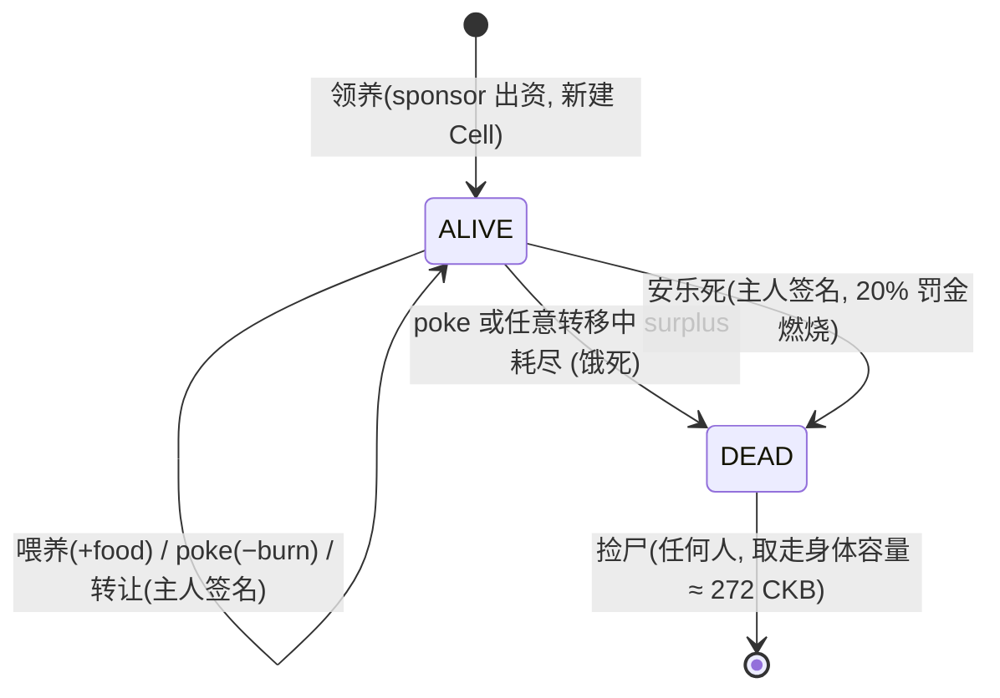

# PetCell 技术方案 —— CKB 链上电子宠物

> 版本:v0.5(2026-10-27)· 状态:**M1 + M2 已实现;安全修复版已部署 CKB testnet**(合约 42 个 CKB-VM 集成测试 + 前端构建全绿,真实 testnet smoke 与 Type+Data2 攻击复测通过,见 §12)
> 工作代号 **PetCell**(宠物细胞):一条 CKB Cell 就是一只宠物。
>
> **v0.2 实现期修订**(与 v0.1 的差异,正文已按实现更新):
> 1. **pet-lock 改为共签(co-sign)模式**——args 携带 owner 的完整 lock 哈希,主人操作要求交易里同时消耗一个 owner 自己的 lock 锁定的 Cell(由 owner 的原生 lock 验签)。任何 owner lock(JoyID/secp/multisig)零适配即用,§10 头号风险(JoyID 签名进自定义 lock)就此消解;
> 2. **基因公式修正**——v0.1 的 `blake2b256(header ‖ tx_hash ‖ index)` 存在循环依赖(tx hash 依赖含基因的 output data,链上无法构造),实现改为 `blake2b256(出资 out_point.tx_hash ‖ 出资 index ‖ 宠物 output index)`,研磨成本 = 真实手续费;
> 3. **反尘土规则**——feed/transfer 的整笔交易手续费必须 ≥ 代谢燃烧,否则「每天喂 0.001 CKB 重置饥饿时钟」可让宠物永生(状态不可区分,只能靠手续费结构堵);
> 4. **pet-type args = pet-lock code hash(32B)**——强制宠物 lock 使用指定代码,堵住任意 lock 伪装;
> 5. 占用容量实测校准:`8 + data + (33+lock_args) + (33+type_args)` 字节,脚本 molecule 表头不计入(与 ckb-gen-types 共识公式一致);
> 6. **安乐死罚金改燃烧**——旧方案要求独立国库输出,但默认 20% 税后 surplus 只有约 3 CKB,低于 secp 国库 Cell 最小占用,真实节点无法上链。

---

## 0. 背景与定位

产品结论(讨论已定,本文档不再论证):

- **宠物 = 一条 CKB Cell**。身体 = 占用容量(occupied capacity),生命值 = Cell 里的富余容量(surplus)。
- **喂养 = 往宠物 Cell 转 CKB**;**代谢 = type script 强制按真实流逝时间烧掉 CKB**;钱烧完了就饿死。
- 死亡是公开事件:讣告卡、耻辱榜、流浪认领、路人捡尸。**永不关服,只会死于你的不管不问。**
- 三类用户三样都要给:图钱的(地板价=锁定的容量,不归零)、图情感的(QQ 宠物关服之痛 + 真金白银会死)、图看热闹的(讣告/捡尸/救人吵架就是传播)。
- 选题迭代中已排除:RGB++ 方向(生态已停滞)、Fiber 方向(未上主网)。

MVP 核心验证假设:**用户会不会为了一个会真死的东西投入真感情**。MVP 范围 = 领养 / 喂养 / 代谢 / 死亡 / 流浪认领 / 讣告分享;繁殖与交易市场放 V1.1。

---

## 1. 总体架构(MVP 无后端)

```
┌─────────────────── 浏览器(Vite + React,纯前端 dApp)────────────────────┐
│  养成页 · 宠物广场(流浪/讣告/耻辱榜) · 分享卡(canvas 本地生成)          │
│  钱包: @ckb-ccc/connector-react(JoyID passkey 登录,无助记词)           │
│  读: get_cells / get_transactions —— 公共 indexer RPC + 客户端增量索引    │
│  写: CCC 组装交易 —— 用户操作(JoyID 签名)/ poke(无签名)/ 捡尸(由捡尸者签名) │
└──────────────────────────────────┬────────────────────────────────────┘
                                   │ JSON-RPC(公共节点)
                    ┌──────────────▼───────────────┐
                    │ CKB 链                        │
                    │  pet-type / pet-lock / config │
                    └───────────────────────────────┘
```

分工原则:

- **MVP 没有后端**:读数据走公共 indexer RPC 在浏览器内索引(§7.1);写交易全部在浏览器组装提交;poke 不需要任何签名,捡尸不需要宠物主人签名,但捡尸者必须提供接收容量和支付手续费的钱包输入(§7.2)。pet-service 推迟到 V1.1+/主网(§7.5)。
- **链上只放规则,不放玩法包装**。状态机、代谢、死亡判定全部在脚本内强制;讣告卡、排行榜是索引层的表现。
- **免 owner 签名路径是一等公民**:代喂、代摸、捡尸不需要宠物主人签名——「reaper(时间的手)」在 MVP 里就是每一个围观的路人:捡尸者主动把濒死宠物摸死,救人者主动喂,社区激励自运转,不需要定时任务。poke 连发送者签名都不需要;捡尸仍需捡尸者自己的钱包签名和手续费输入,因为尸体容量必须落到一个输出地址。
- **用户零门槛**:JoyID 指纹登录;测试网阶段新用户从水龙头领 CKB 后自铸;主网阶段的 sponsor 代铸请回一个只管代铸的轻后端(§7.3)。

---

## 2. 链上核心设计

### 2.1 宠物 Cell 模型

```
Cell {
  capacity: capacity            ← 身体(occupied) + 生命值(surplus)
  lock:      pet-lock           ← args: pet_type_code_hash(32B) + owner_lock_hash(32B)
  type:      pet-type           ← args: pet_lock_code_hash(32B,强制绑定宠物 lock 代码)
  data:      PetData (molecule) ← 见 §4
}
```

- `owner_lock_hash = blake2b256(owner 的完整 lock script 序列化)`(即 `calc_script_hash`)——owner 可以是 JoyID/secp256k1/multisig 任何 lock,**共签模式对 owner lock 零假设**(§2.3)。
- **occupied capacity**(ckb-gen-types 共识公式,已实测校准)= `8 + data.len() + (33 + lock_args.len()) + (33 + type_args.len())` 字节 × 1 CKB/字节。空名字时 data 为 102B,身体为 `8 + 102 + 97 + 65 = 272 CKB`;名字每增加 1 字节身体增加 1 CKB,32B 名字时约 **304 CKB**。这是宠物的「身体」,死了被捡尸的人拿走。
- **surplus** = capacity − occupied,即「生命值 / 口粮」。喂养就是增大 surplus,代谢就是消耗 surplus。
- 共识层保证 `capacity ≥ occupied` 且 `Σ输入 ≥ Σ输出`(差额=手续费),脚本无需重复校验。

### 2.2 时间来源:header dep + load_header(关键决策)

脚本没有「当前时间」,靠 `header_deps` + `load_header` syscall 读取区块头时间戳。

**结论(已查证,RFC 0036,CKB 2021 硬分叉已激活)**:早期 ckb2019 要求 header dep 引用 4 epoch(约 16 小时)前的区块,该 immature 规则**已移除**——现在**任何已存在的区块**都可以作为 header dep。时间戳方案完全可行。

规则设计:

1. 交易在 witness 里声明 **clock_hash**(选定 header dep 中的某一个作为时钟)。
2. pet-type 用 `load_header` 读它,取 `timestamp` 作为 `now`。
3. 所有改变宠物状态的 op 都必须 `now > last_touched`;`now == last_touched` 也拒绝,不能复用输入 Cell 当时使用的旧 header 原地重置。纯 poke 还要求 `Δt >= min_poke_interval`。
4. 代谢结算:`burn = max(burn_per_day × Δt, min_burn)`(shannons)。
5. 输出必须 `last_touched = now`,即**每一次宠物状态转移都要代谢结算**。

**为什么无法伪造时间(攻击面分析,务必实现时复核)**:

- header dep 只能引用**已存在**的区块,拿不到未来时间 → 只能少报 elapsed(冰冻),不能多报。
- **少报仍然存在**:脚本只能验证 witness 声明的 header 存在,无法证明它是“最接近当前真实时间的 header”。攻击者仍可挑一个较旧但晚于 `last_touched` 的 header,少结算代谢。严格前进规则只堵住“复用同一旧 header 反复重置”,不等于可信 wall-clock;`min_burn` 只提供单次下限,不能证明冰冻无利可图。该风险保留,见 §10。
- **区块时间不严格递增**:CKB 共识只要求新块 timestamp 大于过去 37 块的中位时间,并不保证子块 timestamp 严格大于父块。前端“tip 前 8 块”只是降低 reorg 风险的选择,不能把 header timestamp 当作单调、可信的真实时钟。
- **reorg 边界**:若时钟区块被链重组吞掉,交易及其后代失效。前端/服务端组装交易时选 **N=8 确认**的区块作时钟即可(不选最新块),代价是时间精度 ±1 分钟,无关紧要。

### 2.3 职责划分:lock 管认证,type 管规则(本设计的心脏)

type script 无法感知签名是否通过,lock script 不该重复游戏逻辑。两者职责严格分离:

**pet-lock(认证)** —— args `[pet_type_code_hash(32B), owner_lock_hash(32B)]`,**共签(co-sign)模式**:

1. **创建**(组内无输入):放行——铸造不需要认证,合法性由 type 的 T8 把关。
2. **主人路径**:交易中存在**任意一个**输入 Cell,其 lock script 哈希 == args 里的 `owner_lock_hash` → 放行一切。原理:那个 Cell 由 owner 的原生 lock(JoyID/secp/multisig 均可)锁定,签名校验由它自己完成——**pet-lock 不做任何密码学,owner 换 lock 类型零适配**。
3. **免 owner 签名路径**(代喂/poke/捡尸):仅当满足以下**全部**结构条件时放行(然后交给 type 判定合法性):
   - 本输入 Cell 的 type script **完整 script hash** == args 里的 `pet_type_code_hash`(保证宠物规则脚本在场);
   - 组内有输出时,输出也必须是同 type 的宠物(禁止借摸 Pet 之名把宠物 Cell 洗成普通 Cell);
   - **Σ(非宠物输出) ≤ Σ(非宠物输入)** —— 陌生人不能净赚任何 CKB;
   - 组内无宠物输出(捡尸路径)——合法性由 type 判定 `state == DEAD`。

> 头号风险(JoyID 签名进自定义 lock)在共签设计下自然消解:JoyID 用户照常给自己的 Cell 签名,pet-lock 只认「owner 的 lock 出现在输入侧」。ckb-testtool 42 个集成测试即以此模式验证(测试用 always-success / secp256k1 充当 owner lock;JoyID 只影响前端签名方式,不影响脚本)。

**pet-type(游戏规则)** —— 对包含宠物 Cell 的**每笔**交易(输入侧或输出侧)执行:

| # | 不变量 |
|---|--------|
| T1 | `genes`、`version`、`generation`、`birth_time`、`breed_lock_until` 永不变 |
| T2 | 时钟严格前进:`out.last_touched == clock.timestamp` 且 `clock.timestamp > in.last_touched` |
| T3 | 代谢账目:`burn = max(burn_per_day × Δt / 天, min_burn)`(u128 运算防溢出) |
| T4 | **feed**(主人或陌生人):ALIVE 保持;`surplus_out ≥ max(surplus_in − burn, 0)`、**整笔 tx fee ≥ burn**(反尘土);欠代谢超过 surplus 时余额饱和为 0,缺口由 owner/代喂者的额外输入支付 |
| T5 | **poke**(无签名,Δt ≥ min_poke_interval):纯代谢 `cap_out == cap_in − burn`;若 `burn ≥ surplus` 则饿死:`state=DEAD、cap_out == occupied、surplus_out == 0`,且整笔 fee ≥ 死亡前 surplus |
| T6 | **transfer**(仅 owner):ALIVE 保持;`surplus_out ≥ max(surplus_in − burn, 0)`;tx fee ≥ burn;仅此 op 可变更 owner lock hash;欠费缺口同样由 owner 额外输入补足 |
| T7 | **euthanize**(仅 owner):ALIVE→DEAD、`cap_out == occupied`、**整笔 tx fee ≥ burn + max(post-debt surplus, 0)×20%**(罚金直接燃烧);欠费缺口由 owner 额外输入补足 |
| T8 | **loot/消费**(组内无宠物输出):所有被消费宠物必须 `state == DEAD` |
| T9 | **领养**(组内无宠物输入):`genes == blake2b256(出资 out_point.tx_hash ‖ 出资 index ‖ output_index)`,`last_touched == birth_time`,`generation == 1`,`capacity ≥ occupied + adopt_min_surplus` |
| T10 | owner 判定与 pet-lock 同源:type 自己扫描输入侧,存在 lock 哈希 == 宠物 lock args[32..64] 的输入即 owner 在场;owner 不在场时仅允许 feed(无提取)/poke/loot |
| T11 | **禁止同 ELF 多 script group**:CKB 按完整 script hash 分组;同一 ELF 用 `type` / `data1` / `data2` 会产生不同组,而每组都能看到整笔 tx fee。pet-type 必须通过 CellDep 把每个宠物 type script 解析到实际 ELF `DataHash`,若其 ELF 哈希等于当前脚本、但完整 script hash 不是当前组,整笔拒绝 |

### 2.4 状态机

链上只有两个状态:**ALIVE / DEAD**。「挨饿」不进链——它是 `surplus < 星线` 的表现层状态(前端算),省一个状态字段和一堆多余转换。上轮讨论说的「正常/挨饿/尸体」三态对应关系:正常 = ALIVE & surplus 充裕;挨饿 = ALIVE & surplus 低于阈值;尸体 = DEAD。



---

## 3. 操作与交易结构(状态转换规则表)

统一记号:Δt = 时钟间隔;burn 按 §2.2;surplus_in/out 按占用容量差计算。

| # | 操作 | 发起者 | 需要谁的签名 | 交易结构 | lock 规则 | type 规则 |
|---|------|--------|--------------|----------|-----------|-----------|
| 1a | **领养·自铸 adopt** | 用户本人(第二只起 / 加密原生用户) | owner(用户 JoyID) | in: 用户 cell → out: 新宠物(身体 ≈ 272 + 初始口粮 20 CKB)、用户找零 | 规则 1 | T8 基因派生、最小 surplus |
| 1b | **领养·代铸 sponsor-mint** | 平台 sponsor(冷启动)或朋友(送礼) | 仅出资人(用户零签名零成本) | in: 出资人 cell → out: 新宠物(pet-lock args 写入收宠人 lock hash)、出资人找零 | 宠物是新 Cell,无宠物输入即领养 | T8;收宠人 lock hash 取自其地址的完整 script hash |
| 2 | **喂养 feed** | 主人 | owner | in: owner cell + pet → out: pet(+food, last_touched=now)、owner 找零 | 规则 1 | T3 T4, surplus 增加 |
| 3 | **代喂 feed-4-free** | 任何人 | 无 | in: 代喂者 cell + pet → out: pet(+food)、代喂者找零 | 规则 2(陌生人不得净赚) | T3 T4 |
| 4 | **摸 / 催代谢 poke** | 任何人或 reaper 服务 | 无 | in: pet → out: pet(−burn);fee 从宠物 surplus 出,摸的人**一分钱不花** | 规则 2 | T3 T5;Δt ≥ min_poke_interval;burn ≥ surplus → 转 DEAD |
| 5 | **转让 / 卖出 transfer** | 主人 | owner | in: pet + owner 额外输入 → out: pet(owner lock→买家)、主人找零 | 规则 1 | T6;owner lock hash 变更仅此 op 允许;合约没有独立“提现口粮”路径 |
| 6 | **安乐死 euthanize** | 主人 | owner | in: pet + owner cell → out: pet(DEAD, capacity=occupied) + 主人找零 | 规则 1 | T7:主动 DEAD;fee ≥ 代谢债 + 20% 税后 surplus,罚金燃烧 |
| 7 | **捡尸 loot** | 任何人 | 捡尸者钱包签名(不是 owner 签名) | in: pet(DEAD) + 捡尸者手续费输入 → out: 捡尸者 cell(capacity − fee) | 规则 2 第三条 | T8:仅 DEAD 可被消费;必须提供接收容量和手续费输入 |

设计要点:

- **领养在链上就是铸造**:任何「创建了宠物 Cell 但交易中没有宠物输入」的交易都是领养,由 T9 验证基因派生与最小 surplus——谁组装、谁签名不改变链上语义。
- **代铸是通用结构,不只属于平台**:出资人与 owner 天然解耦——平台代铸(冷启动漏斗)、**朋友代铸(送礼:「送你一只会死的宠物」,不烧平台预算的裂变)**、自己代铸给自己(=自铸)。新用户的第一只几乎必然走免费代铸;自铸的真实需求来自第二只以后:基因研磨(每 ≈ 272 CKB 一抽,≈252 CKB 可退,等于花 20 CKB 买一张彩票)、繁育囤栏(V1.1 每个繁育商需要多只亲本)、自托管偏好,以及 sponsor 停摆时的去中心化兜底。
- **代铸 ≠ 托管**:代铸交易里收宠人没有任何输入,所以不需要其签名;宠物 lock 的 args 写入收宠人完整 lock script hash,之后一切主人操作(喂、提、卖)都要本人签名。出资人对这只宠物没有任何特权,它只是代付了首付款。唯一例外是 §10 头号风险:若 JoyID 签名验证 spike 失败、退化为托管模式,所有权才是假的——那是要重新评估产品的情况。
- **防女巫**:平台代铸需在链下按 owner lock hash 限领 1 只 + 每日配额;自铸与朋友代铸无限制(出资人自己花钱,成本即门槛)。当前 MVP 无平台代铸,链上没有该配额逻辑。

- **poke 的手续费从宠物自己的 surplus 里出**(fee = Σin − Σout),摸的人零成本 → 「任何人都能摸」不需要激励补贴,手贱即可。
- **弃养不是 bug,是设计**:主人什么都不做,宠物每隔一段时间被 reaper/路人 poke,按真实时间烧钱,几日后 surplus 归零 → DEAD → 尸体(≈272 CKB 身体)公开可捡。挨饿倒计时、救人还是等捡尸、讣告、耻辱榜,全部由这条路径自然产生。
- 安乐死罚金(20%)确保理性退场优先于弃养,耻辱榜上的名字都是「真·不管不问」;罚金直接燃烧而非进国库——避免小额国库输出低于 CKB 最小占用而无法上链。

---

## 4. 数据结构(molecule)

```text
// pet-type 的 data
table PetData {
    version:        Uint8,      // 0
    state:          Uint8,      // 0 = ALIVE, 1 = DEAD
    genes:          Byte32,     // 32B 基因熵,领养时派生后永不变
    birth_time:     Uint64,     // 领养时刻时钟
    last_touched:   Uint64,     // 上次转移时刻时钟
    generation:     Uint32,     // 第几代,初代 = 1
    breed_lock_until: Uint64,   // 繁殖冷却(V1.1)
    name:           bytes,      // ≤ 32 字节
}

// pet-config 的 data(参数 Cell,项目方 multisig 可升级)
table PetConfig {
    version:              Uint8,
    burn_per_day:         Uint64,  // shannons/天
    min_burn:             Uint64,  // 每次 poke 最低燃烧
    min_poke_interval:    Uint64,  // 秒;限制高频 poke,不能单独解决少报时钟
    adopt_min_surplus:    Uint64,  // 领养时最少口粮
    starve_line:          Uint64,  // 表现层星线(链上不校验,仅索引展示)
    breed_burn:           Uint64,  // 繁殖燃烧(V1.1)
    breed_cooldown:       Uint64,  // 秒(V1.1)
    euthanasia_penalty_bp: Uint16, // 安乐死罚金,万分比(税后 surplus,燃烧)
}

// witness(input_type 槽位,宠物输入侧;raw bytes,不是 molecule table)
// [op: Uint8][clock_hash: Byte32] = 33 bytes
// op: 0=feed 1=poke 2=transfer 3=euthanize 5=adopt
// loot 不读 witness;4=LOOT 保留但当前未使用
```

pet-type 的 **args = pet-lock code hash(32B)**;当前经济参数硬编码在 pet-type 中。V1.1 若引入 config Cell,应增加独立 args 或保留此绑定并扩展布局。

---

## 5. 基因系统

### 5.1 编码

`genes = blake2b256(出资 out_point.tx_hash ‖ 出资 index(u32 LE) ‖ 宠物 output_index(u32 LE))`

- **为什么不能用 tx_hash**:v0.1 设想的 `blake2b256(header ‖ tx_hash ‖ index)` 存在循环依赖——genes 写在 output data 里,而 tx hash 覆盖 output data,链上永远无法构造。实现改为「出资 Cell 的 out_point」:它先于领养交易存在,脚本用 `load_input_out_point(0)` 即可复算,T9 完全链上验证;
- 研磨成本:每个新随机源需要一个新出资 Cell(一笔真实交易费),批量造 N 个出资 Cell 摊薄成本但受限于块空间——研磨是「有手续费的抽卡」,不是免费;
- 脚本侧 `load_input_out_point(0, Input)` 取出资 out_point,与前端 `ccc` 计算完全一致(集成测试覆盖)。

### 5.2 性状表(32 字节解码,纯前端逻辑,链上只验熵源)

| 字段 | 来源 | 取值 |
|------|------|------|
| species 物种 | genes[0] | 6 种(猫/犬/兔/蛙/鸡/章鱼——上线前投票定) |
| palette 配色 | genes[1..3] | 12 色板 |
| eyes / mouth / pattern | genes[3..6] | 各 16 种 |
| personality 性格 | genes[6] | 8 种(影响待机动作与讣告文案) |
| aura 特效 | genes[31] | `0xFF` 时传说特效(1/256) |
| **稀有度** | 全基因 | 数前导零 bit:`≥10` 传说 / `8–9` 史诗 / `5–7` 稀有 / 其余普通 |

稀有度分布由 blake2b 自然给出,早期免费领养期间稀有基因自然沉淀给早起玩家(早期红利)。

### 5.3 繁殖(V1.1,不进 MVP)

- 繁殖交易:两个亲本 pet Cell(均 ALIVE、surplus ≥ 星线、过了冷却)+ 繁育者出资 Cell → 输出:两个亲本(last_touched=now)+ 一个子代宠物(繁育者付身体与口粮)。
- 子代基因:`child = blake2b256(gA ‖ gB ‖ dep_header_hash)`,逐性状 45% 随 A / 45% 随 B / 10% 变异(重哈希该性状位)。
- `generation = max(A, B) + 1`;燃烧 `breed_burn = 30 CKB`(通缩);冷却 7 天(链上以 `breed_lock_until ≤ clock` 强制)。

---

## 6. 脚本工程实现(contracts/)【已实现】

- **框架**:Rust + ckb-std 1.1(纯 Rust no_std,未用 capsule;hand-written molecule codec in `common/`,schema 参考 `schemas/pet_data.mol`)。
- **工程结构**(实际):

```
contracts/
├── common/          # PetData 编解码、参数常量、witness 布局(脚本/测试共享,前端 TS 镜像)
├── pet-type/        # 游戏状态机(§2.3 T1–T10;args = pet-lock 代码哈希)
├── pet-lock/        # 共签认证(§2.3;零密码学,owner lock 哈希匹配 + 无签名路径结构检查)
├── always-success/  # 测试专用 owner lock
└── tests/           # ckb-testtool 集成测试(真实 CKB-VM,42 个用例)
```

- **构建关键(踩坑记录)**:`.cargo/config.toml` 对 riscv target 配置
  `-C target-feature=+zba,+zbb,+zbc,+zbs -C passes=lower-atomic`
  (与官方 ckb-script-templates 一致)。CKB-VM 无原子指令;不要用老方案
  `RUSTFLAGS="-C target-feature=-a"`——新版 rustc 的 LLVM 会在 `bytes` crate 的
  原子引用计数上直接编译崩溃。`debug!` 宏仅在 `debug_assertions` 下编译,发布构建零开销。
- **cycles**:pet-type 全路径 < 2M cycles(历史实测),远低于 70M 上限;新增跨 script hash 扫描会提高上界,最终以部署前 dry-run cycles 为准。
- **测试**(全部通过,`cargo test -p pet-tests`):领养 ok/口粮不足/基因错、poke 燃烧/过频/燃烧额不符/饿死、
  主人喂/陌生人喂/尘土重置拒绝/抽资拒绝、转让 ok/无主拒绝、安乐死足额燃烧 ok/罚金不足拒绝、捡尸 ok/活体拒绝、
  feed/transfer/euthanize 同 header 重置拒绝、严格前进 1 ms 通过、同 ELF 经 Type/Data2 双组多宠物拒绝。
- **部署**:见 `deployment/README.md`;code hash 由 `scripts/hash_elfs.py` 提取并注入前端。

---

## 7. 前端架构(MVP 无后端)

> MVP 不自建后端:读走公共 indexer RPC 在浏览器内索引,写全部在浏览器组装提交。poke 完全不需要签名;捡尸免 owner 签名但需要捡尸者钱包输入,所有交易仍在浏览器内组装,天然 serverless。pet-service 推迟到 V1.1+/主网(§7.5)。

### 7.1 读数据:纯前端索引

- **活体列表**:新版 ckb 节点已内建 indexer RPC(`get_cells` / `get_transactions`;亦可用独立 [ckb-indexer](https://github.com/nervosnetwork/ckb-indexer) 公共实例),前端按 pet-type script `get_cells` 拉全量活体宠物,PetData 的 molecule 解码在浏览器完成(schema 简单,手写解码器即可)。
- **挨饿与倒计时是客户端推算的虚拟状态**:`剩余时间 = surplus / burn_per_day`,链上只在下一次转移时结算——显示先行、结算滞后,机制本就允许。
- **讣告流 / 互动日志**:`get_transactions`(script 过滤)增量扫描,客户端在 localStorage 记水位块号、只扫新增;死亡讣告 = 死亡交易(饿死/安乐死)的输出 PetData,单次 `get_transaction` 取全。扫描深度设上限(如最近 2 万块),更早的讣告随用户持续访问逐步补全。
- **限流对策**:激进缓存 + 2–3 个公共 RPC 端点轮换 + 增量同步;MVP 规模(数千只内)完全够用。

### 7.2 写交易:全部浏览器内

| 操作 | 组装 | 签名 |
|------|------|------|
| 自铸 / 喂养 / 转让 / 安乐死 | CCC | 用户 JoyID 签名,fee 用户出 |
| 代喂 | CCC | 出资人签名(需连接钱包) |
| **poke** | CCC | **无需任何签名**,任何访客浏览器可直接组装并 `send_transaction`,连钱包都不用连;cell deps 与部署 out_point 硬编码在前端配置 |
| **捡尸(loot)** | CCC | **不需要宠物主人签名**,但必须连接捡尸者钱包,提供接收尸体容量的输出地址和手续费输入;不能用无钱包路径 |

### 7.3 被裁掉的后端职能与替代

| 原职能 | MVP 替代 | 何时请回后端 |
|--------|----------|--------------|
| sponsor 代铸 | 测试网水龙头领 CKB → 用户自铸 | 主网上线时:一个只管代铸 + owner lock hash 配额的轻函数(私钥不能进浏览器) |
| reaper 定时摸 | 社区激励自运转:捡尸者为拿约 272 CKB 基础身体主动摸死濒死宠物,救人者主动喂——「时间的手」就是围观群众 | 不需要,机制自带 |
| OG 分享卡 | 客户端 canvas 生成讣告卡 + 截图保存/转发(微信场景本来就走截图) | 需要 Twitter/Discord 爬虫预览时 |
| 挨饿 push 提醒 | 前端 Notification API(标签页开着才有效) | 要离线 push 时 |

### 7.4 前端工程(Vite + React + TypeScript)

- **钱包**:[@ckb-ccc/connector-react](https://www.npmjs.com/package/@ckb-ccc/connector-react)(CCC 是官方推荐的一站式 SDK,内建 JoyID/MetaMask/UniSat 连接器;若做 JoyID-only 可用 `@ckb-ccc/joy-id`)。**实现前核对当前版本 API**(SDK 迭代快,参考 [CCC 文档](https://docs.nervos.org/docs/sdk-and-devtool/ccc))。
- **页面**:
  1. **我家** —— 宠物大立绘 + 生命值条(surplus 换算「还能饿 X 小时」)+ 喂食按钮;
  2. **广场** —— 流浪待救(倒计时 + 喂它/等捡尸)、讣告流、耻辱榜;
  3. **领养** —— 一键自铸(JoyID 签名,钱包出资);无 CKB 用户引导水龙头 → 引导教程;
  4. **宠物详情** —— 基因/性格/互动日志(「谁在我快死的时候喂了我」)。
- **挨饿提醒**:前端 Notification API + surplus 换算,快饿死时弹「它撑不过今晚」。

### 7.5 何时必须加后端

主网 sponsor 代铸漏斗、大规模讣告检索与搜索、离线 push、公共 RPC 限流扛不住(自建 ckb-indexer + 聚合 API)。每一项都可以独立引入且不返工:前端读写的接口形态与有后端时一致,只是把实现从「服务端函数」换成「RPC 直调」。

---

## 8. 经济与商业模式

### 8.1 参数表(当前部署常量;config Cell 治理留 V1.1)

| 参数 | 初值 | 说明 |
|------|------|------|
| burn_per_day | 5 CKB | 口粮消耗速率 |
| min_burn | 0.21 CKB | = burn_per_day/24;单次代谢下限,不构成对少报时钟的安全证明(§2.2) |
| min_poke_interval | 1 小时 | 防高频 poke 刷 tx |
| adopt 初始口粮 | 20 CKB | ≈ 4 天不喂到星线 |
| 星线(表现层) | < 10 CKB | = 2 天口粮,前端显示「挨饿」 |
| 安乐死罚金 | 20% post-debt surplus | 直接燃烧(§8.2) |
| 繁殖燃烧(V1.1) | 30 CKB | 通缩 |

死亡时间线(初值下):领养后**约 4 天**不喂进入星线,**约 4–6 天**饿死。足够形成「它撑不过今晚」的紧迫感,又不至于一夜弃游。

### 8.2 平台收益

**现状:MVP 平台零收入、纯支出**(sponsor 领养补贴 + 基础设施),这是有意的:经济系统越纯,「会不会有人心疼」的验证越干净。收益位置按契合度排:

| 收益点 | 时机 | 形态 |
|--------|------|------|
| CKB 生态 Grant | 现在 | Eco Fund / 黑客松资助 sponsor 预算,现实中的第一笔钱 |
| 安乐死罚金 | 随 MVP 上线 | 当前不进入平台收入,直接燃烧;避免 20% 小额输出落在 CKB 最小占用以下。未来若需要国库,必须把罚金并入同一输出或设置最低领养 surplus |
| 交易市场手续费 | V1.1 市场 | 平台 UI 抽 2%;链上裸转让抽不到税(UI 层收入,护城河 = 分发,NFT 平台通例) |
| 装饰与增值服务 | V2 | 纯视觉消费品,CKB 计价;这是离「第二价值锚」最近的一步,刻意最后做、克制做 |

**红线(设计原则)**:平台永远不从代谢、喂养、捡尸中抽一分钱——三者是「死亡是真的」的信任基础,平台一碰就有「你巴不得我的宠物死」的嫌疑。平台收入只站在**转手**(市场费)与**退场**(安乐死罚金)的位置上。

---

## 9. 里程碑

| 阶段 | 内容 | 产出 | 预估 |
|------|------|------|------|
| M0 | 设计冻结 | 本文档 | ✅ |
| M1 | 链上脚本 | capsule 工程、molecule、pet-type/pet-lock、testtool 全路径测试、devchain 联调 | 2–3 周 |
| M2 | 前端 MVP(无后端) | 四页面 + CCC/JoyID + 纯前端索引与读写全流程(领养→喂→摸→死→捡尸) | 3–4 周 |
| M3 | 测试网 Beta | Aggron 部署、水龙头 + 自铸领养、种子用户验证「会不会真有人心疼」 | 1–2 周 |
| M4 | 主网 + V1.1 | 主网上线;轻后端(sponsor 代铸/聚合)按需引入;繁殖系统、交易市场 + 手续费、排行榜赛季 | 后续 |

---

## 10. 风险与待验证假设

| 风险 | 等级 | 缓解 |
|------|------|------|
| ~~JoyID 所有者签名在自定义 lock 中的验证成本~~ | **已消解** | v0.2 共签模式:owner 用原生 lock(JoyID 等)给自己共签的 Cell 签名,pet-lock 零密码学(§2.3);测试全部通过 |
| 冰冻/少报时钟(选择旧 header dep) | **高,未彻底解决** | 严格 `now > last_touched` 只阻止同一旧 header 反复重置;旧 header 少报仍受 `min_burn` 单次下限约束,但没有证明无利可图。可信时间需要可信时钟/预言机或多方作证;当前 MVP 不提供 |
| 尘土喂养重置饥饿时钟 | **已消解** | 反尘土规则:feed/transfer 整笔手续费必须 ≥ burn(testtool 已覆盖) |
| 基因循环依赖(tx hash 含基因) | **已消解** | 基因改从出资 out_point 派生(§5.1) |
| 同 ELF 跨 `hash_type` 多 script group 共享 fee | **已消解(本地 VM + testnet)** | pet-type 扫描全部输入/输出,用 CellDep `DataHash` 解析实际 ELF,拒绝同 ELF、不同完整 script hash 的第二组;`two_pets_same_elf_via_type_and_data2_fail` 以及 input-only/output-only 两个独立用例通过。真实 testnet 上正常 Type FEED 与 Data2 shadow FEED 单只均 ACCEPT,合并共享 12 CKB fee 被节点拒绝 `ERR_SCRIPT_GROUP=11`(§2.3 T11、§12) |
| header dep 时钟区块被 reorg | 低 | 组装时选近期确认区块;交易失败自动换块重组 |
| sponsor 被刷领养(女巫) | 中 | MVP 用水龙头(自带限额),无此风险;主网代铸时每 owner lock hash 限 1 只 + 每日配额 |
| 无后端:公共 RPC 限流、讣告靠客户端增量扫描 | 中 | 多端点轮换 + 激进缓存 + 水位增量同步;规模爆量即触发 §7.5 加聚合层 |
| ckb-indexer / JoyID SDK 接口变动 | 低 | 锁版本;接口薄封装 |
| rustc/LLVM 版本升级破坏 riscv 构建 | 低 | `.cargo/config.toml` 固化 lower-atomic 标志;CI 跑 `cargo build` 兜底 |
| **核心产品假设:用户会为「会真死的东西」投入真感情** | — | M3 测试网就是验证本身;MVP 不做繁殖/市场,验证失败损失最小 |

---

## 11. 参考资料

- [RFC 0036 – Remove Header Deps Immature Rule](https://github.com/nervosnetwork/rfcs/blob/master/rfcs/0036-remove-header-deps-immature-rule/0036-remove-header-deps-immature-rule.md)(时间方案依据)
- [RFC 0022 – Transaction Structure](https://github.com/nervosnetwork/rfcs/blob/master/rfcs/0022-transaction-structure/0022-transaction-structure.md) / [RFC 0009 – VM Syscalls](https://github.com/nervosnetwork/rfcs/blob/master/rfcs/0009-vm-syscalls/0009-vm-syscalls.md)(load_header)
- [capsule 脚本开发框架](https://github.com/nervosnetwork/capsule) · [ckb-indexer](https://github.com/nervosnetwork/ckb-indexer)
- [CCC(CKBers' Codebase)SDK](https://github.com/ckb-devrel/ccc) · [Nervos 官方 CCC 指南](https://docs.nervos.org/docs/integrate-wallets/ccc-wallet) · [@ckb-ccc/connector-react](https://www.npmjs.com/package/@ckb-ccc/connector-react)
- [RFC 0026 – Anyone-Can-Pay](https://github.com/nervosnetwork/rfcs/blob/master/rfcs/0026-anyone-can-pay/0026-anyone-can-pay.md)(代付模式参考)

---

## 12. 实现状态(2026-10-27,as-built)

**M1(链上脚本)+ M2(前端 MVP)代码完成;安全修复版已部署 CKB testnet,并完成真实 smoke 与攻击复测。**

| 模块 | 状态 | 验证 |
|------|------|------|
| `contracts/common` | ✅ | 7 个单元测试(编解码/容量公式/witness) |
| `contracts/pet-type` | ✅ riscv64 ELF | 15 个 CKB-VM 集成测试覆盖全部 7 种操作 + 攻击路径 |
| `contracts/pet-lock` | ✅ riscv64 ELF | 同上(共签/无签名/捡尸/反洗 Cell) |
| `contracts/tests` | ✅ **42/42 通过**(ckb-testtool,真实 VM) | `cargo test -p pet-tests` |
| code hash 提取 | ✅ | `deployment/code_hashes.json` + 前端自动生成 |
| `web/` 前端 | ✅ tsc + vite build 全绿 | CCC 1.23 + connector-react 2.2(JoyID);四页面 + 程序化 SVG 宠物 + demo 模式(`?demo=1`) |
| demo 模式目视验收 | ✅ | 浏览器截图验收:卡片/饥饿条/挨饿徽章/传说特效/死亡灰化/详情弹窗/广场三 tab |
| 测试网部署 | ✅ 修复版已 committed/live | pet-type deploy tx `0x91e318fd6057085b1d11f2fbb69dc8d61eaac0c3949d0373a41df6047e785d42` block `22878281`;pet-type wrapper `0xb120a01d…`,复用 pet-lock wrapper `0x4e9c281d…`;链上 data 与本仓库 ELF byte-for-byte 一致 |
| testnet smoke | ✅ A 领养/feed/transfer + B 饿死/loot + C 安乐死/loot | 2026-10-27 `mvqjb6li` 9 笔二次确认 `committed` 并追踪精确 outpoint;机器可读记录见 `deployment/smoke-latest.json` |
| Type+Data2 攻击复测 | ✅ 真实 testnet dry-run 拒绝 | 组合交易 `ERR_SCRIPT_GROUP=11`,未广播;结果见 `deployment/type-data2-attack.json` |

实现期设计修订(v0.1 → v0.2):pet-lock 共签化(§2.3)、基因公式去循环依赖(§5.1)、反尘土手续费规则(§2.3 T4)、pet-lock code hash 入 pet-type args(§2.1)、安乐死罚金改燃烧、占用容量公式校准(§2.1)。参数仍为部署期常量(`common/src/lib.rs`),config Cell 治理留 V1.1。

**已知的 MVP 边界**(接受并记录):捡尸需连接钱包(尸体的容量要有个去处);
时钟统一取 tip 前 8 个区块,降低短期 reorg 风险,但不是可信 wall-clock,
少报时间风险仍在;当前“讣告/耻辱榜”只来自 live 的死宠 Cell,尸体被捡走后会
消失,尚未接入历史交易索引;hidden dust-reset 之外的 griefing(高频代喂)只受
手续费成本约束;尚无独立第三方审计或形式化验证。前端 30 秒定时器会重新读取链
tip/宠物 Cell,而不是仅本地重渲染。
